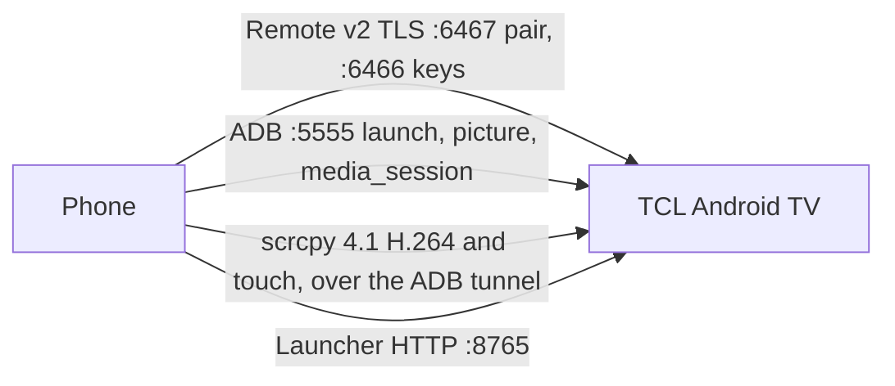

# TV Remote

An Android remote for TCL Smart TVs over Wi-Fi, faster and more capable than the Google Home remote.

`lt.kantrybes.tvremote` · Kotlin · minSdk 29

## Screenshots

Drop the images at these paths when you have them.


## Features

### Remote

Android TV Remote protocol v2. Pairing is TLS on port **6467**; keys go over a long-lived TLS session on port **6466**. The TV shows a code; the phone sends the pairing secret. After that, the server certificate is pinned per host.

The remote screen has a D-pad (with a separate button-cluster layout), volume, mute, power, and a keyboard. Text uses the protocol’s IME messages. Characters the IME does not accept fall back to ADB `input text`, which is ASCII only.

Brightness (and, if enabled in Settings, contrast, saturation, and sharpness) is set through TCL’s `ShowWindowService` over ADB. There is no direct picture API without root.

Wake-on-LAN sends a magic packet to the MAC from Settings before each connect attempt. While the app is in the foreground the session retries every 2 seconds, and 12 seconds without a message forces a reconnect. Leaving the app drops the sockets; coming back starts them again. Short standby reconnects quickly. A long standby (30 minutes or more) has not been verified.

TV discovery (`_androidtvremote2._tcp`) is not implemented. You type the TV’s private IPv4 address. `RemoteAppLinkLaunchRequest` is off: this TV closes the command session when it arrives.

### App shortcuts

YouTube, Netflix, Stremio, and Go3, plus any package you add. Each launch resolves the leanback activity once with `cmd package resolve-activity`, caches `package/activity`, and then runs `am start -n`. Monkey is only the fallback. App links stay implemented but are not used unless that host is explicitly marked as supporting them (this TV is not).

### Screen mirroring

scrcpy **4.1**, pushed over ADB and decoded with MediaCodec. Touch on the picture is injected on the control socket. The view can go fullscreen.

Two presets: **Smooth** (768 px, 24 fps) and **Light** (512 px, 12 fps). While video is playing and you have not just picked a preset, the mirror switches to Light, then returns to Smooth when playback stops. Audio is not requested (`audio=false`).

### Media card

Not a card inside the app. While the remote session is up, the phone polls `dumpsys media_session` over ADB about every 3 seconds. If something is playing or paused, a foreground media session named “TCL TV” shows on the notification shade and the lock screen: title, app, play/pause, next, previous, and relative volume (the phone’s volume keys). It starts only while this app is in the foreground, and it stops after 10 minutes of silence, 60 seconds without the TV, or if you dismiss it. There is a Settings toggle.

### Share → TV

Share a YouTube link to the app. It opens that URL on the TV with an ADB `am start` view intent, shows a toast, and finishes. Other text is rejected. Opens are limited to one every 2 seconds.

### Kantrybės TV launcher

The phone manages the [Kantrybės TV launcher](https://github.com/tkestas92/tv-launcher) on the same TV:

- reorder and edit favorites
- hide and unhide apps
- pick a wallpaper (`night`, `aurora`, `sunset`, `forest`, `ocean`, `graphite`)
- launch an app
- load launcher icons

Talks plain HTTP to `http://<tv-ip>:8765` with a bearer token. Pairing is `POST /pair` with the PIN from the TV (**Settings → Phone** on the launcher). There is no launcher discovery; the address is the TV IP already saved for the remote. The phone only accepts a private LAN address. While the Launcher screen is visible it calls `GET /state` on resume and every 5 seconds, and signs out if the TV answers 401.

The demo flavor does not open this API.

### Demo flavor

`demo` (`lt.kantrybes.tvremote.demo`) installs a socket factory that refuses every connection. A virtual TV draws a home grid: D-pad, volume, power, keyboard, shortcuts, YouTube share, picture-slider banners, and a fake mirror (a colored preview, not H.264). Pairing accepts any 6-digit code. A looping “Demo video” drives the same notification media card. The launcher screen stays on its “no real TV” message.

## Architecture

One activity. `full` and `demo` implement the same `TvBackend` (`remote`, `adb`, `mirror`, `nowPlaying`, `discovery`). UI is Compose: `ui/remote`, `ui/screen`, `ui/settings`, `ui/launcher`, `ui/share`.

| Package | Role |
|---|---|
| `data/remote` | TLS pairing, command session, Wake-on-LAN, certificate pin |
| `data/adb` | dadb on port 5555: launch, picture intent, `media_session`, share |
| `data/scrcpy` | scrcpy 4.1 messages; `full` runs the server and MediaCodec |
| `data/launcher` | HTTP client for the TV launcher |
| `media` | Notification / lock-screen `MediaSession` |
| `backend` | Full sockets, or the demo virtual TV |



Keys stay in app-private storage. Backups are off. The launcher uses cleartext HTTP only after the address checks out as a private LAN IP.

## Build

Flavors: `full` (real TV, dadb) and `demo` (no network, `applicationId` suffix `.demo`).

```bash
./gradlew assembleFullRelease
./gradlew assembleDemoRelease
```

The release build type does not read a keystore, so these APKs are unsigned:

- `app/build/outputs/apk/full/release/app-full-release-unsigned.apk`
- `app/build/outputs/apk/demo/release/app-demo-release-unsigned.apk`

`keystore.properties` is gitignored. [keystore.properties.example](keystore.properties.example):

```properties
storeFile=/absolute/path/to/tvremote.jks
keyAlias=your-key-alias
storePassword=your-store-password
keyPassword=your-key-password
```

## Setup on the TV

1. Enable network ADB (port 5555). The first connection shows **Allow USB debugging** on the TV; the phone keeps that RSA key.
2. In the app, enter the TV’s private IP and pair. The TV shows a code on the Android TV Remote pairing screen (port 6467).
3. For the launcher screen, open **Settings → Phone** in Kantrybės TV and enter that PIN. Wrong codes can lock pairing for the `Retry-After` period.

## Known limitations

- Android 9 on this TV: no audio in the mirror.
- DRM apps (Netflix, Go3 streams) may mirror as a black frame.
- The TV only exposes a software H.264 encoder, so the mirror takes about 2–3 seconds to start. Sizes must be multiples of 16; Smooth and Light are.
- Not built: scenes, sleep timer, Quick Settings tile, home-screen widget, mDNS discovery, and a control-only mirror (`video=false`).

## Tech stack

Kotlin, Jetpack Compose, Material 3, Coroutines and Flow, DataStore, dadb, protobuf-lite, scrcpy 4.1, MediaCodec, MediaSession.

## Related

[Kantrybės TV launcher](https://github.com/tkestas92/tv-launcher) — the TV-side home screen this app configures over HTTP.
